# Lost Signal 88.8

Project #2: Online Store, made with Lovable, Midjourney, Higgsfield, ElevenLabs and Claude

Live site: https://lost-signal-merchstore.lovable.app

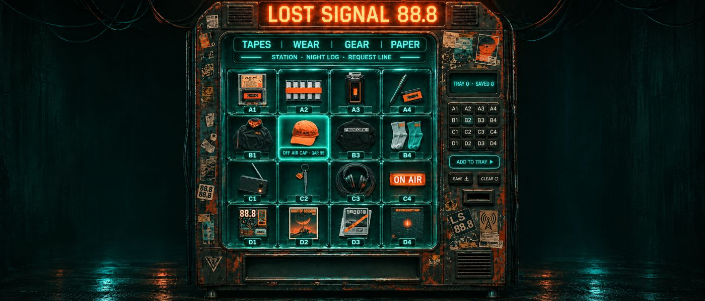

Lost Signal 88.8 is a merch store for a pirate radio station that only broadcasts at night. The station sells its stuff from an old vending machine in a corridor, so I made the whole website the vending machine. You pick things from the slots or type a code on the keypad, the product shows up on a hologram next to the machine, and when you check out the receipt prints out of the machine.

## The world

I spent a lot of time on the story before making anything, because I wanted the site to feel like somewhere you end up at 2am.

88.8 is an illegal radio station. It broadcasts from a little booth on the roof of an old concrete tower, where the top corner of the building has broken off. From the street you can see the booth glowing orange through the gap, with a homemade antenna sticking out. It's only on air from 8pm to 6am.

Downstairs there's a corridor nobody uses at night, and in it there's a vending machine that stopped selling soda years ago. The station rewired it and filled it with things they make: tapes, hoodies, radios, posters. During the day the machine is off and there's a note taped to the glass that says "OUT OF ORDER TILL 8PM. Still takes coins though." At night it lights up.

The people buying are night owls in Doha, like taxi drivers, people on night shifts and people who can't sleep. The Night Log page follows one night at the station, from 8pm to 6am.

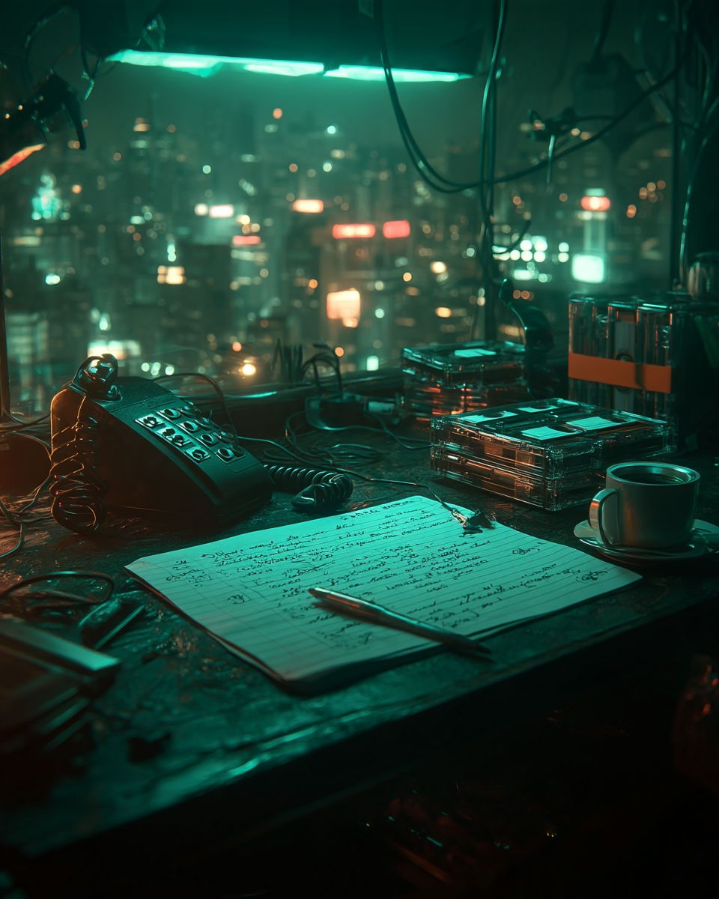

There are 16 products in four rows: Tapes (A1 to A4), Wear (B1 to B4), Gear (C1 to C4) and Paper (D1 to D4). Each one has a slot code, a price in riyals, limited stock and a line of copy in the station's voice. My favourite is the ON AIR Lamp: "The same red light that hangs over our booth door. Plug it in and nobody walks into your room without knocking."

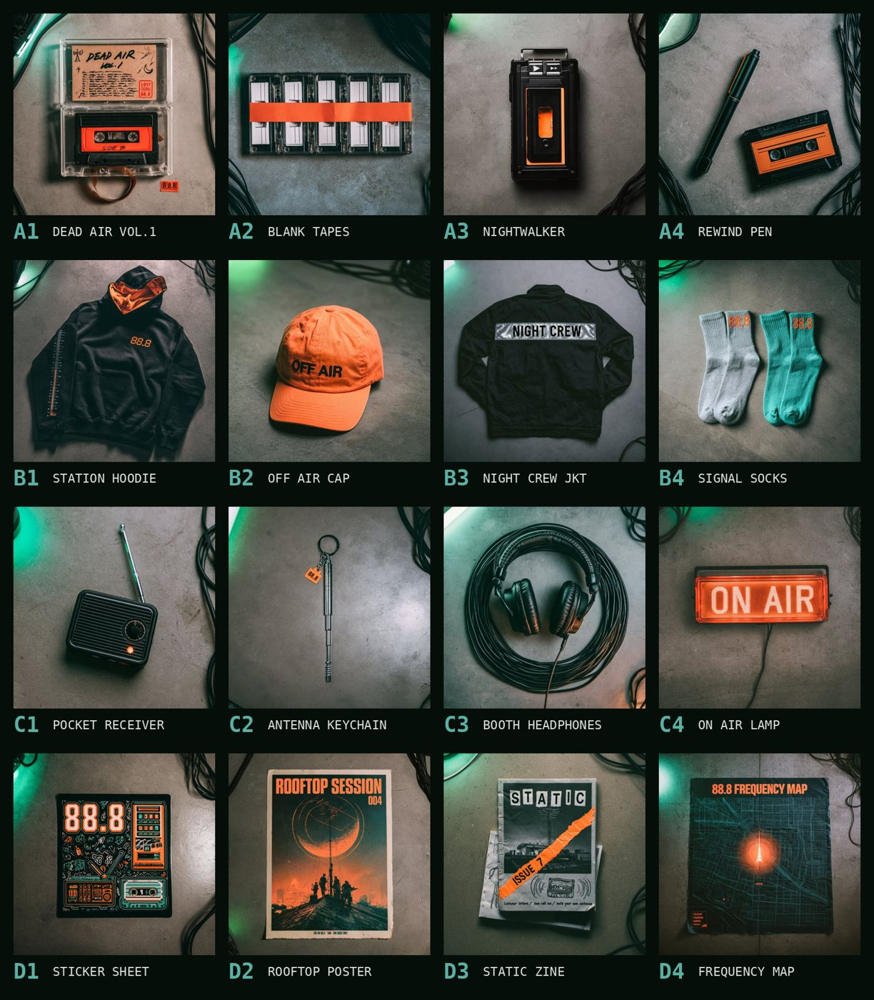

## Initial prompt and how the idea changed

I started by brainstorming directions with Claude.

The first few directions didn't feel right. One was a Pakistani truck art store, which I liked, but I didn't want the store to be tied to that. Others felt too much like a marketing project, and I wanted this to be about interaction. The main thing I wanted was for it to be cool.

Out of the next round I liked three separate ideas: a store that only opens at night, a store that is a vending machine, and a pirate radio station. I decided to put all three together, so the vending machine belongs to the pirate station and it only comes alive after dark. That became Lost Signal 88.8.

Later I pushed it further. I didn't want a normal store layout with the machine as decoration, I wanted the machine to be the actual interface, where the glass, keypad and slots are how you shop and the receipt comes out of the machine itself.

The workflow ended up being:

Claude (idea, copy, brand guide, prompts) → Midjourney (the look, products, scenes) → Higgsfield (fixing images, hover images, layout guide) → ElevenLabs (sounds and music) → Claude (cleaning up audio, a clickable prototype) → GitHub → Lovable (the actual site, in phases) → Claude (checking the live site and writing fix prompts)

A lot of people would start with a Lovable template and build from there. I did it the other way around. I made the world and all the images first, then a prototype of how the machine would work, and only then started in Lovable. I think that saved me a lot of back and forth later.

## Copy and brand

Before any images, Claude and I wrote all the copy into one document: the product names, prices and descriptions, the About page, the contact form, the 404 page, the receipt and some fake listener reviews. Having it all in one place helped because every tool after that used the same words.

The colours came from the Midjourney images. Once I picked a style, Claude pulled the colours out of my images:

| Name | Hex | Use |
|---|---|---|
| Basement Black | #050E08 | Background |
| Stairwell Green | #15291A | Panels |
| Oxidized Teal | #4E8D78 | Borders |
| Machine Glow | #5BB0A5 | Glows and links |
| ON AIR Orange | #E8693C | Buttons and prices |
| Fog | #D8E6DF | Text |
| Static | #8FA79A | Small text |

The fonts are Archivo Black for headings, Inter for body text and VT323 for codes, prices, the machine's screen and receipts. The one rule I kept is that orange is only for things you can click or buy.

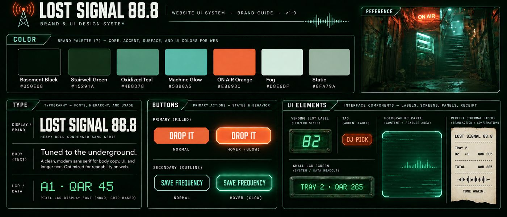

## Midjourney

I ran the same vending machine scene in three styles: harsh flash photos, neon noir and a 90s disposable camera. I went with neon noir, then tried it on a radio booth to make sure it worked on something else too.

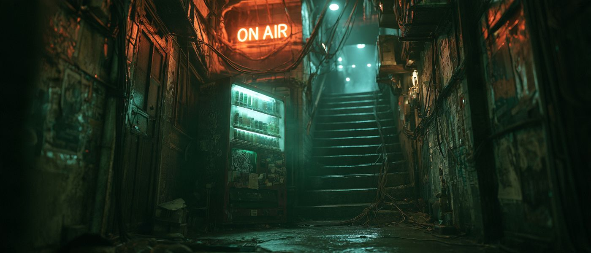
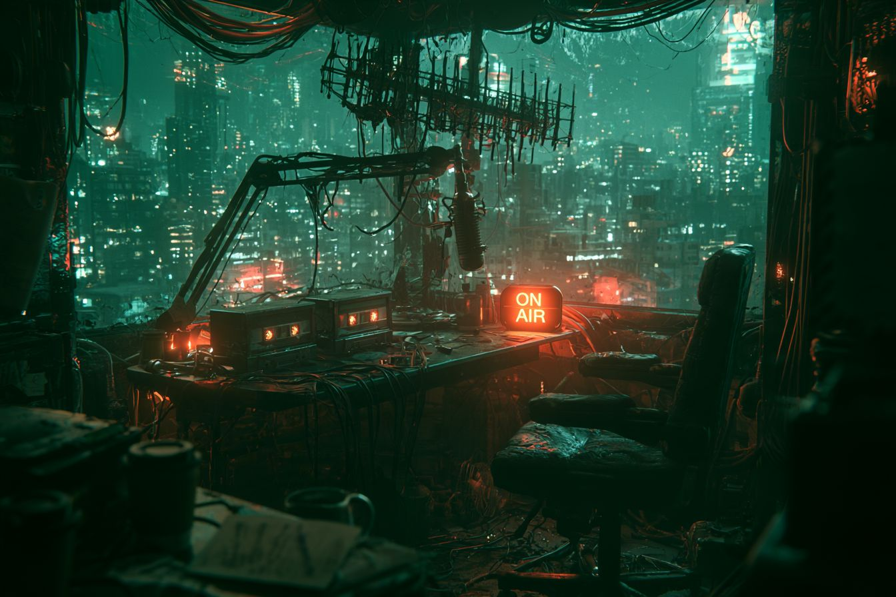

The products were the hardest part of the whole project. The first hoodie looked like wet leather and the hood was standing up on its own. After that most products came out too dark and green, and then they came out really grainy, almost like cement.

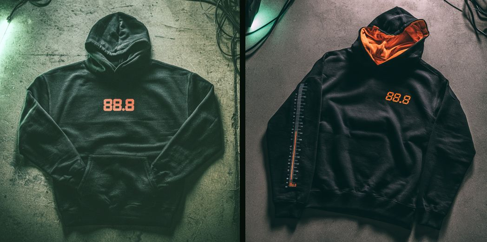

What fixed it in the end:
- Shooting everything from straight above on a grey concrete floor, with normal light on the product and the green only around the edges.
- Using a product I actually liked as the style reference. I had been using the bad hoodie, which is why everything looked like it.
- Lowering the reference weight and adding "film grain, noise, HDR, vignette" to the `--no` list, because the grain was coming from the reference image.
- Shooting the cap at an angle, since from above you couldn't read "OFF AIR".

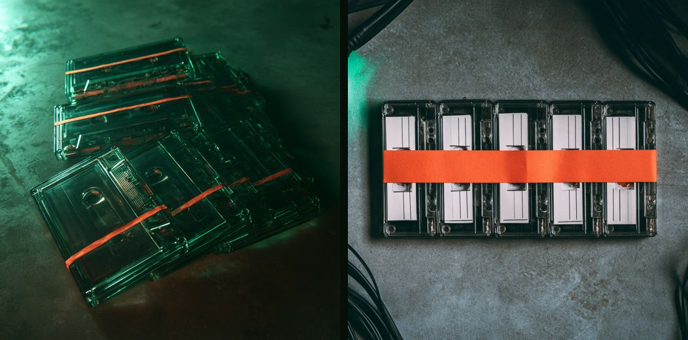

Some products were just boring at first. The poster was literally one word on a page, so I asked for a proper gig poster with an illustration of a band on a rooftop. I did the same for the zine and the map.

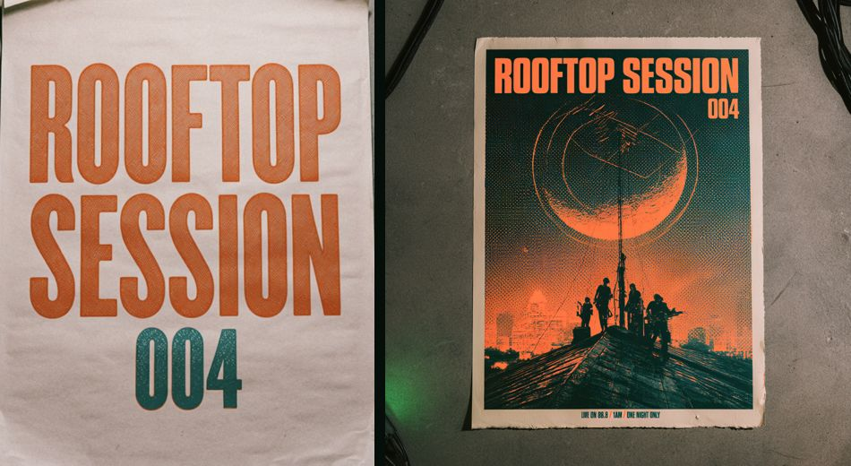

An example of a final product prompt:

```
bright, well-lit overhead flat lay product photo of a brand new orange six-panel baseball cap with "OFF AIR" embroidered in black on the front panel ... on a smooth grey concrete floor, bright neutral white studio flash on the product showing its true colors, faint green glow and loose black cables only at the very edges of the frame ... --ar 1:1 --s 50 --sw 50 --no person, hands, film grain, noise, HDR, vignette, dirt, scratches
```

## Higgsfield

Midjourney is bad with text, so "88.8" and "OFF AIR" kept coming out wrong. I used Nano Banana Pro in Higgsfield to fix the text without changing anything else in the image.

The vending machine came out of Midjourney with six rows of slots and I needed four. Higgsfield fixed that and added the sign. Then I messed up the day version by editing the original image instead of the fixed one, so it had six rows again and didn't match the night one. I had to redo it.

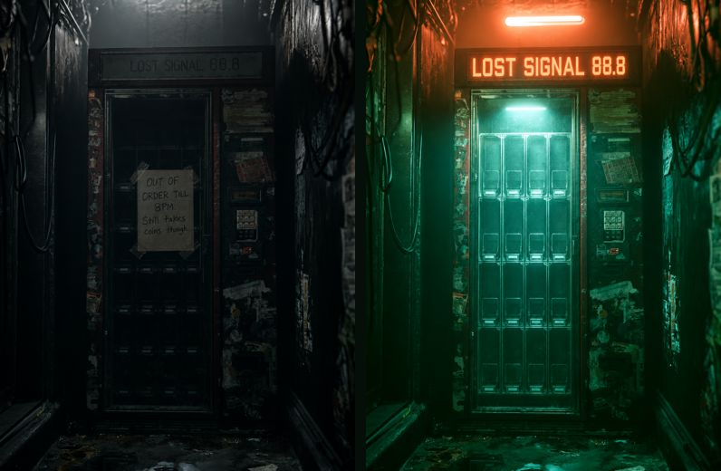

The hover images show each product out in the world. My first ones looked pasted in, because the product was lit like a studio photo while everything around it was dark. Changing the prompt from "keep it exactly as it is" to "use it as a design reference and relight it to match the scene" fixed it.

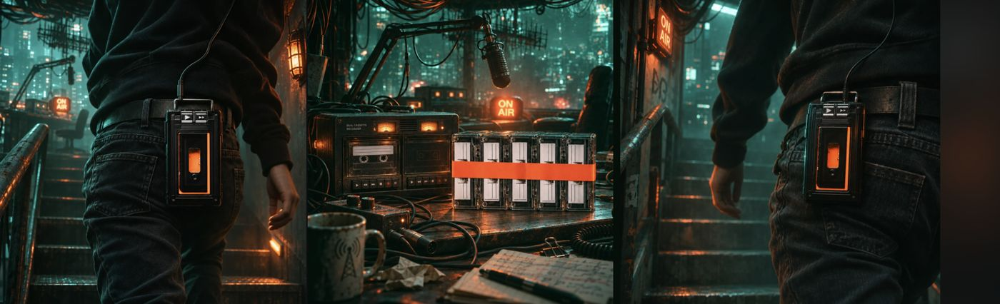

Any time there was a person in the image they came out looking like an anime character, so I stopped showing faces. People are shown from behind, cropped, or it's just hands.

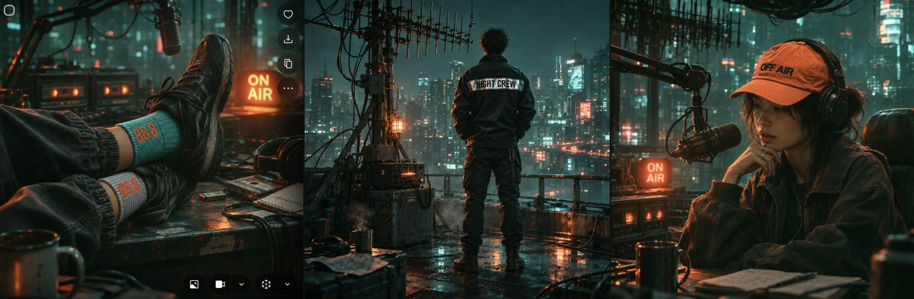

At one point I only had 70 tokens and each image was 3.5, so I used Gemini for free fixes like changing a floor colour and saved Higgsfield for the harder edits.

I wanted a proper brand and layout guide before building, so I made one in Higgsfield with a UI kit and the main screens: Tune In, the machine with products, the product hologram, cart, checkout, receipt, the exit screen and mobile. I also rebuilt the machine at a higher resolution with a proper keypad and screen so it could work as the actual interface.

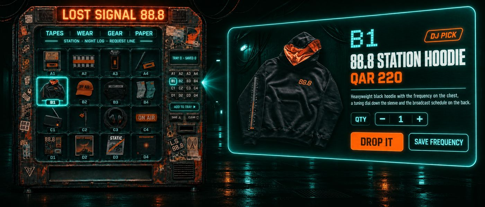
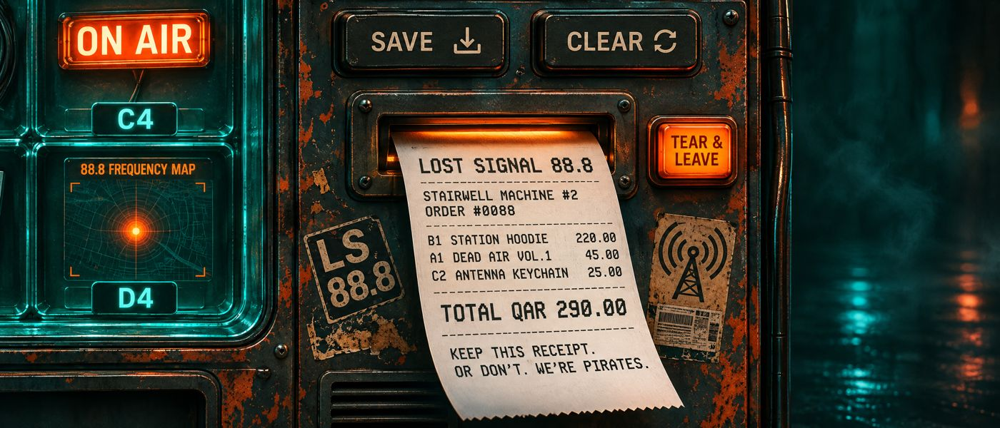
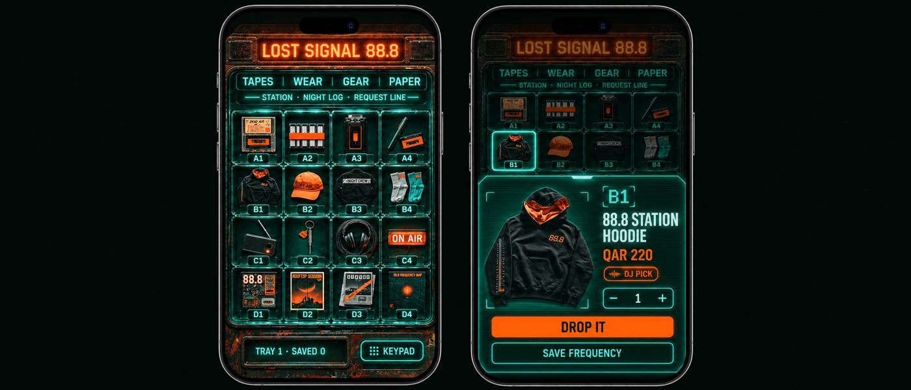

The empty version of the machine is the background of the website:

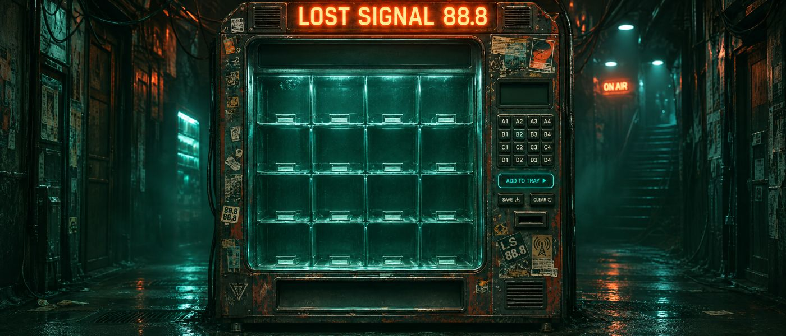

## The video that didn't work

I wanted a short video of the machine switching on. I gave Midjourney's Animate the dark machine as the start frame and the lit one as the end frame. Every time, it turned the paper note into water and the glass started melting. Rewording the prompt didn't help, and neither did an idea where the glass slides down like a shutter.

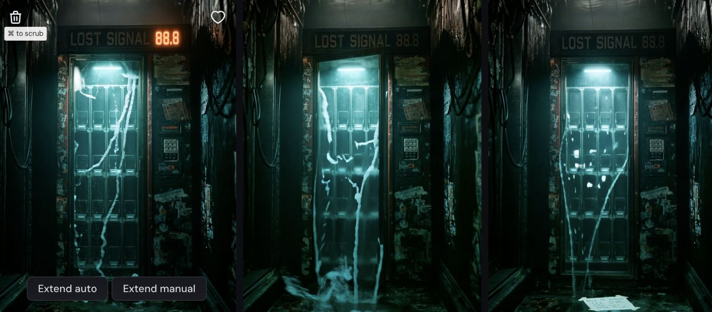

So I dropped the video. The switch-on on the site is coded instead: it flickers between the dark and lit images like an old tube light, with haze and a buzzing sound, and the note falls off. It ended up sharper than the video would have been, and I can change the timing whenever I want.

## Sound

All the sounds are from ElevenLabs: a coin dropping, an item landing in the tray, a keypad beep, a rattle for the jammed slot, radio static, a tube light flickering on, a neon buzz and a lo-fi track. Claude cut the silence off them, evened out the volumes and made the buzz loop smoothly.

I was going to add DJ voice lines as well but I took them out. It's a store, people are there to buy things, and a talking DJ would just get annoying.

## The prototype

Before touching Lovable, I had Claude code a clickable prototype using my real images and sounds, so I could test my idea for the interface. This is where I could finally see if the idea worked: clicking slots, typing on the keypad, the hologram coming out of the keypad, items dropping into the tray and the receipt printing.

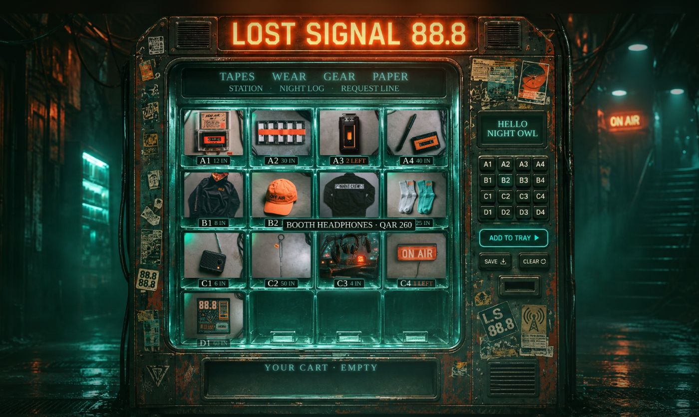
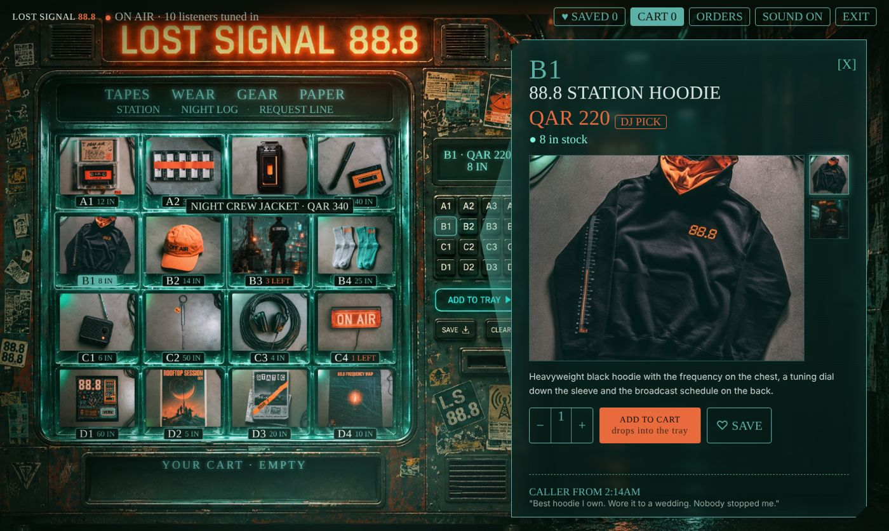

The first version had problems. The slots had no codes, the photos sat weirdly in the slots, some wording was confusing (it said "tray" where it should just say "cart"), there were no hover images and there was a lot of empty space. I also asked for limited stock with live counts, a way to come back and buy again, and a receipt you can download. The second version had all of that, and that's what I gave Lovable as a reference.

## Lovable

Getting my files into Lovable took longer than I thought. It wouldn't take audio files in chat, so everything had to go through GitHub. First I connected the wrong GitHub thing (the API connector, not Git sync). Later I found out I had two Lovable projects and had been prompting one while checking the other.

I built it in six phases and checked screenshots after each one:

1. The machine, camera and slots
2. The hologram, product view and cart
3. The database, live stock and accounts
4. Checkout, the printed receipt and orders
5. The intro, exit, night and day, and sound
6. The menu, extra pages, footer, mobile and polish

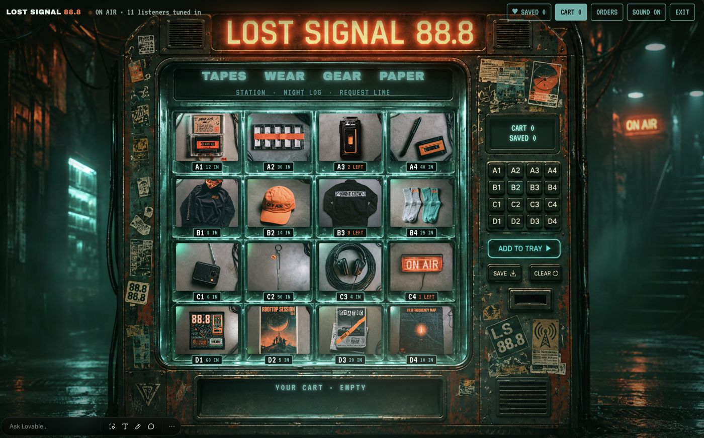
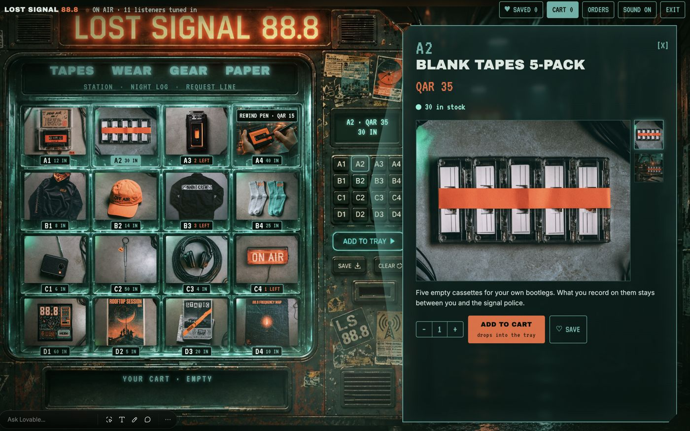
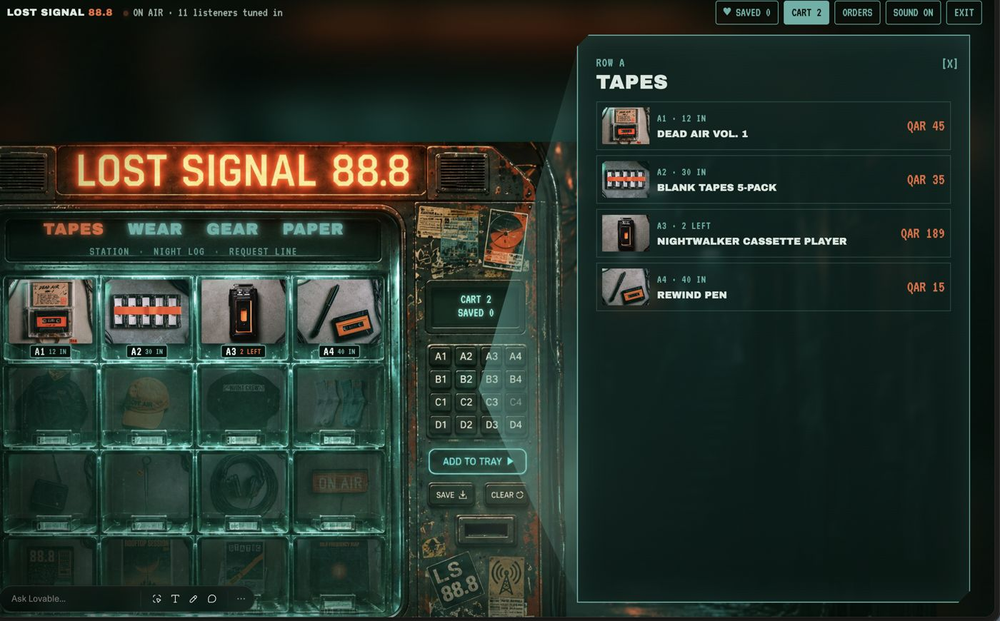
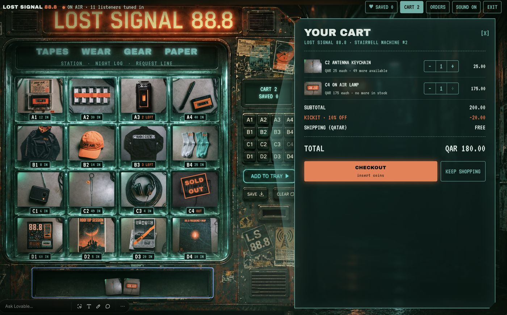

Things that went wrong along the way:
- Mobile broke straight away. The machine was cut off and you couldn't reach the keypad, so I decided to leave mobile until the last phase.
- The hologram covered the keypad, so the machine had to move to the left when it opened.
- Items said "sold out" when they were just in my own cart.
- The discount was wrong. 10% off 25 riyals showed as 3.00 instead of 2.50.
- The top bar had seven buttons and Exit went off the screen. I cut it down to the menu, logo, saved and cart, and moved everything else into a sidebar and a small radio in the corner.
- The fake buyers I added to make the site feel live bought so much overnight that half the machine looked sold out by morning. I slowed them down and made them only buy things that still had plenty of stock.
- The flashlight in day mode made it too dark to actually shop, so I added a "Turn the lights on" button.

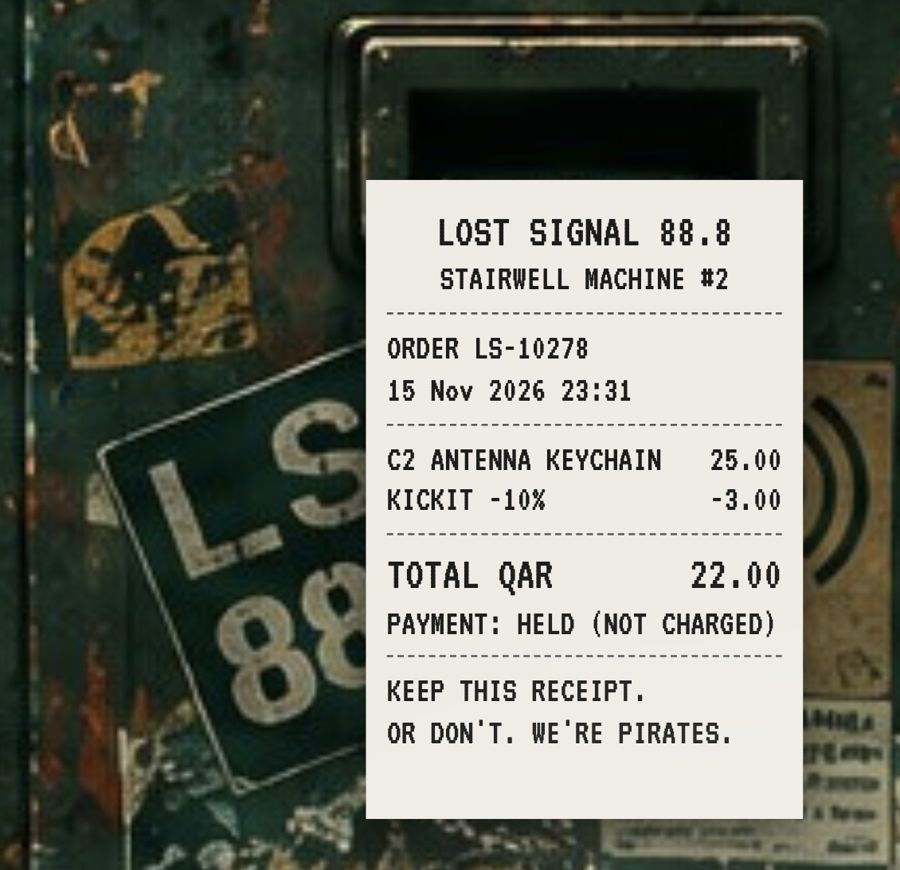

## What the site does

- You start by tuning an FM dial to 88.8, either by dragging the needle or pressing Tune In.
- Clicking a slot or typing its code shows the product on a hologram next to the machine.
- Adding to cart plays a coin sound and the item drops into the pickup tray.
- Stock is limited and the same for everyone, and you can see other "listeners" around Doha buying things while you browse.
- Slot C4 is jammed. If you kick it three times you get 10% off.
- At checkout the receipt prints from the machine and you can download it as a PDF.
- Your orders are saved so you can come back and buy the same things again.
- From 8pm to 6am the machine is on. During the day it's dark and you get a flashlight, or you can turn the lights on.
- There's a secret code on the keypad (it's hinted in the Night Log).
- The Station page is the about page, the Night Log is the lookbook, the Request Line is the contact form, and the 404 page says "Signal lost."

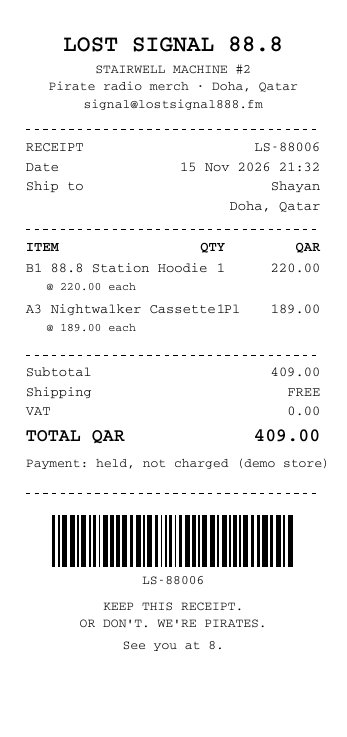

## What I learnt

Working out the world first made every other decision easier. Once I knew where the station is and who listens to it, I knew what the photos, copy and even the error messages should be like.

A style reference in Midjourney copies everything about the image, including the bad parts. Most of my product problems came from using a reference I didn't actually like.

AI image and video tools are still bad at small text and at things changing or disappearing. Knowing that, I fixed text in Higgsfield and coded the switch-on myself instead of fighting the video tool.

Making a prototype before building saved a lot of time. Lovable had working code to copy instead of me trying to describe everything in words.

Doing it in small phases worked much better than big prompts. Every time I gave Lovable a lot at once, something else broke.

A lot of problems only showed up on the live site, at a real time of day and on a normal laptop screen. Checking it after publishing caught the stock running out and the buttons going off the screen.

## Reflection

To be very honest, this took a lot longer than I expected, but not in the way I thought it would. Coming up with the idea was quick. Most of the time went into small things, like the hoodie looking like leather, the cap angle, the video melting, and figuring out GitHub.

I think the best decision was not starting from a template. Because I'd already designed the world, the screens and the prototype, Lovable was building something I'd already decided on instead of guessing what I wanted.

I also had to cut ideas I liked. The DJ voice was fun, but it didn't help anyone buy anything, so it went. That's what I kept checking every feature against.

Tools I used: Claude, Midjourney, Higgsfield (Nano Banana Pro), Gemini, ElevenLabs, Lovable with Lovable Cloud, and GitHub.
